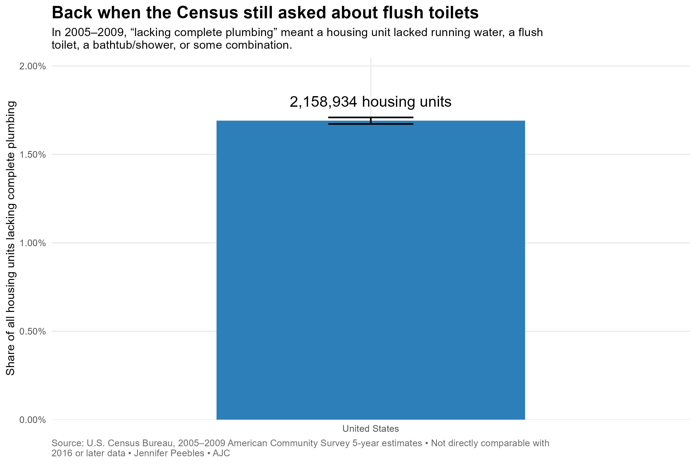
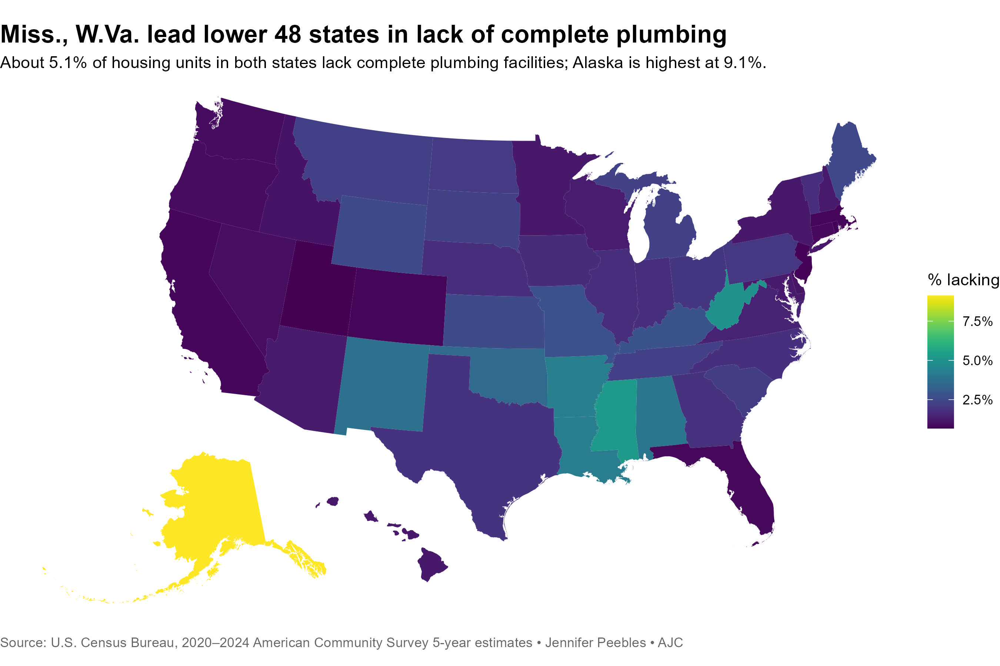

# World Toilet Day

R code for mapping U.S. data at the national, state, county and place level for
World Toilet Day.

### Why data about toilets?

We posted the first version of this script on Nov. 19, 2021, in recognition of
[World Toilet Day](https://www.un.org/en/observances/toilet-day) -- a day
intended to draw greater awareness to the fact that many people in the world
live without proper sanitary sewer service.

Lack of such service brings an increased risk for the spread of numerous
diseases that can be fatal. My own grandmother was orphaned at age 3 in the year 1930 when her
[widowed young mother](https://www.ancestry.com/family-tree/person/tree/280288/person/-2100736346/facts)
died of [typhoid fever](https://en.wikipedia.org/wiki/Typhoid_fever), a disease
that humans contract by drinking water that has been contaminated by human
waste, such as when a well is dug too close to an outhouse or latrine. The death of Mimi's biological mother led to some catastrophic after-effects that she carried with her all her life. A garment worker -- she sewed clothing and children's shoes in industrial clothing plants -- [Mimi had never used a computer, used a cellphone or sent an email](https://www.lowefuneralhomes.net/obituary/Grace-Langford) when she died in 2020, but this code repository is dedicated to her memory. 

Typhoid also took the life of
[my other grandmother's oldest sister](https://www.ancestry.com/family-tree/person/tree/280288/person/-2100736752/facts)
at age 13 -- two young lives lost due to lack of running, clean water and proper
sanitation in rural Georgia.

Throughout human history, diseases like these -- including typhoid, [cholera](https://en.wikipedia.org/wiki/Cholera), [polio](https://en.wikipedia.org/wiki/Polio) and several others grouped under the truly yucky name of those transmitted via the [fecal-oral route](https://en.wikipedia.org/wiki/Fecal%E2%80%93oral_route) -- have claimed human lives by the boatload. [Polio killed or sickened thousands of people](https://en.wikipedia.org/wiki/History_of_polio) around the world prior to the development of vaccines for it in the 20th century; many who survived were left with lifelong physical disabilities. [One of our greatest presidents](https://en.wikipedia.org/wiki/Paralytic_illness_of_Franklin_D._Roosevelt) contracted polio when he was nearly 40, leaving him with physical limitations for the rest of his life. And the [cholera epidemics](https://en.wikipedia.org/wiki/1854_Broad_Street_cholera_outbreak) that hit many major world port cities in the mid-1800s, killing thousands in each wave, would be ended with [the breakthroughs](https://en.wikipedia.org/wiki/John_Snow) that would lead to the birth of both modern epidemiology and what we know call geospatial intelligence. 

Diseases like these have largely been stamped out in the developed world today due to advances in medicine and widespread adoption of modern sewer and septic systems. In fact, one of the things this project does is grab recent data from the CDC to show how few cases of such diseases have been reported within the U.S. recently. (Most people who come down with typhoid or cholera in America today are people who have recently returned from travel to another country.) 

These diseases are still deadly outside our borders, and they claim thousands of lives in the developing world each year. That's what World Toilet Day is about. The United Nations estimates that 2 billion people around the globe use a drinking water source that is contaminated with fecal matter.

And there are still a few places even in the U.S. where people go without such conveniences every day due to poverty, geography or lack of infrastructure. I recall being at a city council meeting in my small hometown as a young reporter in college and the discussion turning to how some of the poorest homes in the city still had toilet facilities that were not connected to the city's small sanitary wastewater system and effectively "flushed" into people's backyards and ran into drainage ditches and small creeks. 

You know what a lot of us kids in my hometown did when we had heavy rain? Ran out and played in those very same ditches creeks. 

### What data is in this project

This repo calls upon plumbing-related data from the
[2020-2024 five-year estimates of the American Community Survey](https://www.census.gov/programs-surveys/acs)
done by the U.S. Census Bureau. 

It also includes a separate, optional module that retrieves national
surveillance figures for typhoid fever, paratyphoid fever and cholera from the
CDC's [National Notifiable Diseases Surveillance System](https://www.cdc.gov/nndss/about/index.html).

The disease data are provided as historical public-health context only. They
are never joined to, correlated with or modeled against the ACS plumbing data.
Most recent U.S. typhoid and cholera cases are associated with international
travel, so a state-level comparison with plumbing access would be misleading.

### About the ACS data

This script retrieves data from the Census Bureau's online data repositories
using the Census's Application Programming Interface (API) and the
[tidycensus package](https://walker-data.com/tidycensus/) of the
[R programming language](https://en.wikipedia.org/wiki/R_(programming_language)),
written by Kyle Walker.

To use this script, you will need a free API key from the Census Bureau. You can
[request one at this link](https://api.census.gov/data/key_signup.html).

ACS data is usually released about a year behind. The five-year average data
combines each metric over the previous five years to provide a less
herky-jerky result than would be provided by annual data releases. Why do we
use the five-year average data? The Census Bureau only publishes one-year data
for the largest cities and counties in America. For everybody else, we have to
use the five-year data -- or choose to wait until the Decennial Census comes around again. 

ACS data is an estimate. The confidence interval is 90 percent. The Census
Bureau publishes margins of error for each metric presented here. Always
remember, the smaller the sample the estimate is taken from, the wider the
margin of error.



But just to be clear, despite my attempts at toilet humor here, we're not
actually counting toilets per se. The ACS questionnaire asks people
if their home has "complete" plumbing facilities, which the Census defined
from 1990 to 2016 as
[hot and cold running water and a bath or shower and a working toilet](https://www.census.gov/data/tables/time-series/dec/coh-plumbing.html). The Census Bureau revised their definition in 2016 to remove the requirement to have a working flush toilet. 
So the metric we're examining is the percentage of all housing units that
have, or lack, complete plumbing facilities. See the Census Bureau's
[official comparison guidance](https://www.census.gov/programs-surveys/acs/guidance/comparing-acs-data/2016.html) for more details.

Much of the data in this summary specifically comes from ACS table B25047,
[which you can read more about here](https://censusreporter.org/tables/B25047/),
"Plumbing Facilities for All Housing Units."

<br clear="right">

### About the CDC data

Run the supplemental disease data module separately:

```r
source("98_run_cdc_context.R")
```

It writes:

- `output/data/cdc_nndss_disease_context_raw.csv`
- `output/data/cdc_nndss_disease_context_annual.csv`
- `output/graphics/cdc_typhoid_cholera_context.jpg`

The CDC weekly tables are provisional and subject to revision. The script
records the retrieval time, source URL, reporting flags and last published
MMWR week (that's Morbidity and Mortality Weekly Report, a weekly publication the CDC puts out) so we do not accidentally add cumulative weekly figures together.

### About this script

The script uses a number of R packages, including the
[tidyverse family of packages](https://www.tidyverse.org/) created by
[Hadley Wickham](http://hadley.nz/) et al. I am also very grateful for packages
including [janitor](https://github.com/sfirke/janitor),
[sf](https://r-spatial.github.io/sf/) and
[tigris](https://github.com/walkerke/tigris). Thank you to the brilliant people
behind these packages who wrote all the code and keep it maintained.

This new version breaks the old R Markdown document into a numbered pipeline
so each step is easier to check, rerun and troubleshoot. A few small helpers I
originally wrote for my private PeeblesToolbox package are included directly
in `00_helpers.R` so anybody can run this public project without needing access
to a private repository.

The pipeline:

1. Retrieves national, state, county and place data.
2. Calculates the shares with and without complete plumbing facilities.
3. Carries through the Census Bureau's margins of error.
4. Calculates the low and high ends of each 90 percent confidence interval and flags
   intervals that overlap zero.
5. Creates ranks, percentiles and QA checks.
6. Ranks Georgia counties and all U.S. county equivalents, with deciles and
   percentiles.
7. Produces CSV data, GeoJSON layers, JPEG charts and maps, and an interactive
   Leaflet county map.

The state maps reposition Alaska and Hawaii beneath the lower 48 so we do not end up
with a gigantic Alaska floating far away from everybody else and squashing the
rest of the country into the corner.



Like most of the code you'll find here on GitHub, this is a work in progress.
There are always improvements I would like to make. The 390 places in the 2023
data with no housing units are one example: their percentage and
margin-of-error calculations are undefined, so the quality assurance script flags them for
review instead of quietly pretending they are fine.

The pipeline also writes `output/data/ci_zero_flags.csv`, which identifies
every geography and metric whose 90 percent confidence interval overlaps zero. Those
estimates should be treated with extra caution.

The output also includes coefficients of variation and plain-language
reliability classes. The coefficient of variation is calculated as the
standard error divided by the estimate, with the standard error calculated as
the published 90 percent margin of error divided by 1.645. The classifications used
by this project are:

- High reliability: CV of 15 percent or less
- Moderate reliability: CV greater than 15 percent and no more than 30%
- Low reliability: CV greater than 30 percent
- Not classifiable: zero, missing or otherwise undefined estimate

The Census Bureau uses 30 percent as an important statistical-quality benchmark, but
these four labels are project-specific aids for readers, not official Census
Bureau classifications.

### How to run this script. 

Before the first run,
install the required R packages and request your Census API key.

Save the API key in your user `.Renviron` file -- never in this project or in a
file you plan to push to GitHub:

```r
tidycensus::census_api_key(
  "YOUR_KEY_HERE",
  install = TRUE,
  overwrite = FALSE
)
```

Restart R after saving the key. Then run the complete project from the project
root:

```r
source("99_run_pipeline.R")
```

If you want to update the ACS year, survey or geographies, change the `config`
list in `00_setup.R`.

When all that is done, open `world_toilet_day_public_script.Rproj` in RStudio. 

### What's in all these numbered scripts?

1. `00_setup.R` -- configuration, dependency checks and output paths
2. `00_helpers.R` -- local chart themes and export helpers
3. `01_import.R` -- ACS retrieval
4. `02_clean_analyze.R` -- cleaning, MOE calculations, ranks and percentiles
5. `03_qa.R` -- structural checks and data-quality flags
6. `04_visualize.R` -- analytical summaries, charts and maps
7. `05_export.R` -- CSV, JPEG, GeoJSON and QA exports
8. `06_rank_counties.R` -- national and Georgia county ranks, percentiles and
   deciles
9. `07_visualize_county_rankings.R` -- Georgia distribution and national and
   Georgia best/worst charts
10. `08_create_interactive_county_map.R` -- self-contained Leaflet county map
11. `11_import_historical_acs.R` -- retrieves a national 2005–2009 historical
    snapshot
12. `12_prepare_historical_snapshot.R` -- documents the old definition and
    prepares the standalone snapshot without making a modern comparison
13. `13_visualize_historical_snapshot.R` -- national historical-context chart
14. `14_render_report.R` -- renders the compact HTML report
15. `16_publish_readme_graphics.R` -- exports the two tracked JPEGs embedded in
    this README
16. `17_run_tests.R` -- runs the automated integration tests
17. `20_import_cdc_context.R` -- optional CDC disease-surveillance retrieval
18. `21_visualize_cdc_context.R` -- optional CDC trend chart and exports
19. `98_run_cdc_context.R` -- runs only the optional CDC context module
20. `99_run_pipeline.R` -- runs the whole shebang in order

Generated files are written to:

- `output/data`
- `output/graphics`
- `output/geojson`
- `output/interactive`
- `output/logs`

The output directory, environment files and RStudio's behind-the-scenes
session files are excluded from GitHub.

Each runner creates a timestamped log containing the configuration, R and
platform details, package versions, script start and finish messages, warnings
and any error that stopped the run. A completion beep sounds when the pipeline
finishes; a different alert sounds if it stops with an error.

### About the old version

The original `world_toilet_day_revision_in_progress.Rmd` is still here as the
benchmark version. We left it unchanged so we would always have the old script
to compare against while rebuilding the project.

Its SHA-256 checksum at the time of the migration was:

```text
08332731D41702439EEE0D2BA8174F1414BB8A2B37E80D39546C99E1117B60F5
```

The text in this README file and in the script has not been copy edited, so
please forgive all typos and style errors. Suggestions are always welcome.
